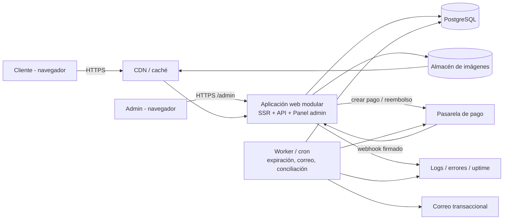
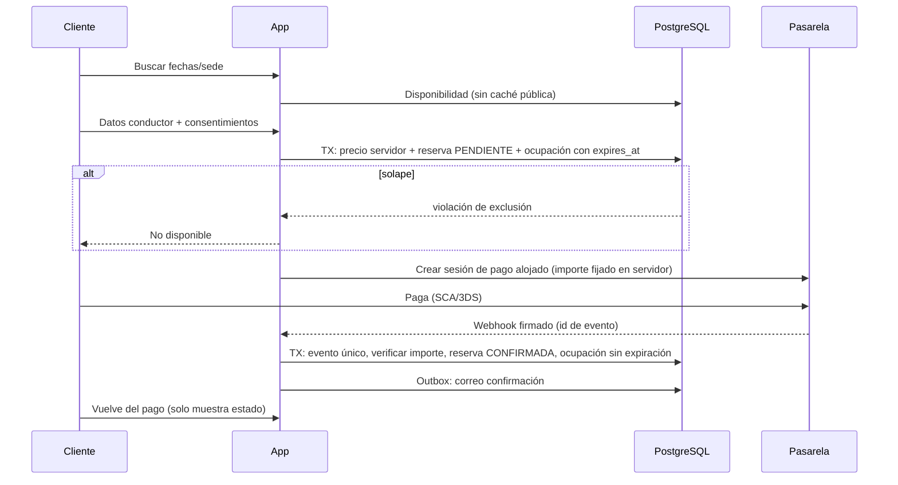

# Arquitectura de solución: Web de alquiler de campers (España)

> **Proyecto:** `alquiler-campers`  
> **Estado del documento:** BORRADOR  
> **Fecha:** 2026-10-26  
> **Fuente:** Reporte del agente Arquitecto de Soluciones ("Arquitectura solución campers"), persistido por el Gestor de Documentación sin cambiar su significado.  
> **Aprobación:** NINGUNA. GATE-002 (DISCOVERY → DESIGN) sigue **PENDING** y el alcance **NO está aprobado** ([APPROVALS](../00-control/APPROVALS.md)). BUILD y despliegue están prohibidos sin autorización expresa del cliente.

**Aviso del Gestor:** todo lo técnico de este documento es **Recomendación [R]**, no una decisión. ADR-001 a ADR-012 son **propuestas pendientes** (ver [DECISIONS](../00-control/DECISIONS.md) §2). Ninguna tecnología es obligatoria.

# Reporte de agente: Arquitectura de solución para el MVP de alquiler de campers (España)

- **Agente:** Arquitecto de Soluciones
- **Objetivo:** Proponer una arquitectura proporcional al MVP del PM, con puntos de extensión para Fase 2.
- **Contrato aplicado:** `arquitecto-soluciones.contract.json`. Fase DESIGN, solo lectura y búsqueda. No hay conflicto: no edité nada ni programé. No cambié el alcance y no declaré ninguna tecnología como obligatoria. Todo lo técnico de este reporte es **Recomendación**.
- **Elementos relacionados:** ARQ-001, ADR-001 a ADR-012, RF-001 a RF-032, RNF-001 a RNF-014, RN-001 a RN-027, DEC-001 a DEC-032 y PEND-001 a PEND-024.
- **Archivos consultados:** `PROJECT-STATE.md`, `DECISIONS.md`, `requirements.md` (RF, RN y RNF), `mvp-and-backlog.md` (alcance, MoSCoW, HU y CA), el contrato del rol y `copilot-instructions.md`.
- **Archivos modificados:** ninguno. **Comandos o pruebas ejecutadas:** ninguna.
- **Evidencia:** solo los borradores citados. No existe repositorio ni sistema previo que inspeccionar.
- **Resultado:** COMPLETADO_CON_PENDIENTES.

**Leyenda:** **[C]** Confirmado · **[S]** Supuesto · **[R]** Recomendación · **[P]** Pendiente.

**Clasificación tecnológica**
- **Obligatoria:** ninguna.
- **Existente:** ninguna. No hay repositorio, sistemas ni migración **[C]**.
- **Recomendada:** todo lo que se nombra aquí.

---

## Contexto y restricciones

- **[C]** Negocio en España. Reservas en línea con pasarela de pago segura. Buena UX, velocidad y SEO. Flota y sedes configurables desde un panel. Sin integraciones con sistemas existentes ni migración.
- **[C]** Quedan fuera del contrato el presupuesto y las fechas.
- **[S]** Alcance MVP según la propuesta del PM (DEC-029), que sigue sin aprobar:
  - Pago total con tarjeta al reservar (DEC-001, DEC-003).
  - Acceso a la reserva con código + email (DEC-005).
  - Un solo rol administrador (DEC-014).
  - Misma sede de recogida y devolución (DEC-012).
  - Español y EUR (DEC-009).
  - Extras y FAQ en Fase 2 (DEC-018, DEC-019).
- **[S]** Volumen bajo o moderado. Tráfico, flota y reservas son desconocidos (PEND-021, PEND-015). No invento cifras.
- **[P]** Proveedor de pasarela (PEND-012), hosting, titularidad de pasarela, dominio y correo (PEND-011), y validación legal (PEND-010).
- **Divergencias Analista/PM que afectan a la arquitectura** (ISS-004 a ISS-011):
  - Extras: el AN los pone en MVP (RF-005) y el PM en Fase 2.
  - Pago: el AN recomienda depósito + saldo y el PM pago total.
  - Cancelación: el AN la ata a la política vigente al reservar y el PM a la vigente al cancelar (ISS-002, CA-008).

  Arquitecto según el PM. Cada divergencia queda cubierta por un punto de extensión (ver tabla en "Arquitectura recomendada"), sin reescribir el núcleo.
- **Pendiente de escalar:** no hay restricción incompatible ni riesgo crítico que impida diseñar. Sí hay una integración no confirmada: la pasarela. La diseño detrás de una interfaz propia (ADR-004).

> Nota del Gestor: la frase "Arquitecto según el PM" y "La diseño detrás de una interfaz propia" se transcriben tal como figuran en la fuente (posibles erratas de redacción del agente). Se interpretan, sin cambiar el significado, como "se arquitectura según el PM" y "se diseña la integración detrás de una interfaz propia". Confirmar con el Director si se desea corregir la redacción.

## Alternativas consideradas

| Tema | Opciones | Valoración **[R]** |
|---|---|---|
| Estilo | A) Monolito modular. B) SPA + API separadas. C) CMS headless + servicios. D) Motor de reservas SaaS | **A**: un solo despliegue, transacciones simples y SEO directo. B/C añaden complejidad sin necesidad probada. D queda fuera: el cliente pide un canal propio, y se podría evaluar aparte |
| Renderizado | SSR/ISR para páginas públicas. SSG puro. SPA cliente | **SSR/ISR con caché**: el catálogo cambia desde el panel y la disponibilidad es dinámica. SPA perjudica SEO y LCP |
| Base de datos | PostgreSQL. MySQL/MariaDB. NoSQL | **PostgreSQL**: restricción de exclusión por rango contra solapes, transacciones y JSON para instantáneas. MySQL exigiría bloqueo de filas a mano |
| Anti doble reserva | Solo comprobación en aplicación. Bloqueo pesimista. **Restricción en BD** + bloqueo temporal | Restricción en BD (ADR-003) |
| Pasarela | Stripe, Redsys, Adyen (o similar) | Ver ADR-005. Sin imponer |

## Arquitectura recomendada

Un monolito modular desplegable como una sola unidad, con un proceso de **worker** para tareas programadas. Usa una base PostgreSQL, un almacén de objetos con CDN para imágenes, la pasarela y un servicio de correo.

**Estructura modular (lógica, no de código):**

| Módulo | Responsabilidad | Extensión Fase 2 |
|---|---|---|
| Catálogo | Vehículos, sedes, contenido, páginas SEO | Traducciones |
| Tarifas | Temporadas, precios, mínimos, cálculo en servidor | Extras como líneas de precio, suplemento por otra sede |
| Disponibilidad | Ocupación y bloqueos, anti-solape | Otras sedes de devolución |
| Reservas | Estados, instantánea de precio, código de acceso | Modificación, reservas manuales, cuenta de cliente |
| Pagos | Interfaz `PaymentProvider`, webhooks, reembolsos, conciliación | Depósito + saldo, otros medios |
| Políticas | Versiones de condiciones, privacidad y cancelación; consentimientos | Edición con versionado (RF-027) |
| Notificaciones | Cola de salida (outbox) y plantillas | Plantillas editables, centro de avisos |
| Admin | Autenticación, CRUD, reservas, pagos | Roles, informes y auditoría |

## Componentes y responsabilidades

- **Web pública (SSR/ISR):** catálogo, ficha, búsqueda, flujo de reserva, consulta por código + email, legales y contacto.
- **API interna:** validación y reglas de negocio en servidor. No hay API pública para terceros.
- **Panel admin:** misma aplicación, ruta `/admin`, `noindex`, autenticada.
- **Worker:** expirar holds, enviar la cola de correo, conciliar con la pasarela y recordatorios si se aprueban.
- **Servicios externos:** pasarela, correo, CDN y almacén de imágenes.

## Flujo de datos

La redirección del navegador no confirma nada (RN-023). Solo confirma el webhook verificado, o una consulta directa a la pasarela como respaldo.

## APIs o contratos principales

Contratos conceptuales, sin rutas definitivas **[R]**:

- **Públicos:**
  - Listar y detallar vehículos y sedes.
  - Consultar disponibilidad y precio: fechas + sede, devuelve desglose.
  - Crear reserva en estado pendiente: devuelve el enlace de pago y la expiración.
  - Consultar reserva con código + email.
  - Cancelar reserva: calcula y devuelve el reembolso.
  - Enviar contacto.
- **Pasarela (entrante):** webhook de pago y de reembolso, con firma verificada.
- **Interfaz interna `PaymentProvider`:** `crearSesionPago`, `verificarWebhook`, `consultarPago`, `reembolsar`, `listarTransacciones`. Un adaptador por proveedor.
- **Admin:** CRUD de flota, sedes, temporadas y tarifas. Listar y filtrar reservas. Cancelar. Bloqueos manuales. Pagos y reembolsos.
- **Convenciones:**
  - Importes en céntimos enteros y moneda explícita.
  - Fechas en `Europe/Madrid`, almacenadas como fecha (`date`) hasta que PEND-013 defina horas.
  - Errores con códigos estables, mensajes comprensibles y una cabecera de idempotencia en las operaciones de creación.

## Modelo de datos conceptual

| Entidad | Contenido clave | Nota |
|---|---|---|
| `branch` (sede) | Nombre, dirección, horarios, contacto, activa | Soporta RN-001 |
| `vehicle` | Sede base, plazas, equipamiento, fianza informativa, activo, imágenes | Se desactiva, no se borra (DEC-028) |
| `season` y `rate` | Rango de fechas sin solape, precio por noche por vehículo, mínimo de noches | RN-007, RN-008 |
| `occupancy` (bloqueo de fechas) | `vehicle_id`, rango `[recogida, devolución)`, tipo (reserva o bloqueo manual), `reservation_id` o nulo, `expires_at` o nulo | Núcleo anti-solape (ADR-003) |
| `reservation` | Código, estado (RN-021), vehículo, sedes de recogida y devolución, fechas, conductor, **instantánea de precio**, referencias a versiones de políticas | `return_branch_id` existe aunque sea igual a la de recogida |
| `reservation_price_line` | Concepto, importe, impuestos | Admite extras sin cambiar el esquema |
| `payment` | Reserva, proveedor, referencia externa, importe, estado (RN-022), tipo `FULL` | El tipo `DEPOSIT`/`BALANCE` entra en Fase 2 |
| `refund` | Pago, importe, motivo, estado, clave de idempotencia, origen (cliente, empresa o admin) | RF-025 |
| `payment_event` | Proveedor, id de evento (único), tipo, carga bruta, estado de proceso | RNF-009, idempotencia |
| `policy_version` | Tipo (condiciones, privacidad, cancelación), versión, contenido o tramos, vigencia | RN-014, RN-026 |
| `consent` | Reserva, versión aceptada, finalidad, marca de tiempo, marketing sí/no | Sin datos de más |
| `admin_user` | Email, hash de contraseña, rol (un valor), MFA | RF-019 |
| `email_outbox` | Tipo, destinatario, plantilla, estado, reintentos | RNF-014 |
| `reservation_status_history` | Cambios de estado con actor y hora | RNF-009, bajo coste |

**Preparado para Fase 2 sin construirlo ahora:** `customer_id` opcional en reserva (cuentas), `payment.kind` (depósito + saldo), líneas de precio (extras), `return_branch_id` (otras sedes), rol como valor enumerado (roles), campos de contenido traducibles (multi-idioma) y tabla de auditoría (RF-029).

## Autenticación y autorización

- **[R]** Cliente: sin cuenta. Acceso por código + email.
  - El código es aleatorio y de alta entropía, no secuencial.
  - La respuesta de error es idéntica sea cual sea el fallo.
  - Hay límite de intentos por IP y por código.
  - Autorización por objeto: solo se ve la reserva cuyo código y email coinciden (RN-025, CA-013).
  - Opción más segura: enlace mágico por correo. Queda como alternativa para el Director.
- **[R]** Admin: email y contraseña con hash adaptativo (Argon2id o bcrypt), sesión por cookie `HttpOnly`/`Secure`/`SameSite`, protección CSRF y bloqueo por intentos. Se recomienda MFA (TOTP) aunque haya un solo rol.
- **[R]** Autorización: comprobación en servidor por rol, con rol único en MVP. El modelo admite más roles después.

## Seguridad y privacidad

- **[R]** OWASP Top 10 y ASVS como guía de verificación:
  - Consultas parametrizadas y validación de entradas.
  - Cabeceras de seguridad y CSP.
  - Dependencias auditadas.
  - Subida de imágenes validada por tipo y tamaño, con reprocesado.
  - Control de acceso por objeto y registro de eventos sensibles.
- **[R]** Pago: pago alojado o tokenizado. La web no recibe ni guarda datos de tarjeta (RNF-006, CA-031). Esto reduce el alcance PCI, pero el cumplimiento depende del proveedor. Validar.
- **[R]** Secretos: gestor de secretos o variables del entorno de despliegue, nunca en el repositorio. Claves distintas por entorno, rotables, y secreto de webhook propio.
- **[R]** Rate limiting en búsqueda, consulta por código, login, contacto y creación de reserva. Anti-bot en contacto.
- **[R]** RGPD, sujeto a PEND-010 (no es asesoramiento legal):
  - Minimizar datos.
  - Registrar consentimientos con versión.
  - Contratos de encargado de tratamiento con hosting, pasarela y correo.
  - Preferir región UE.
  - Definir plazos de retención y un procedimiento de anonimizado o supresión (PEND por definir).
  - Registros sin datos personales.
- **[R]** Cookies: solo técnicas por defecto. Cualquier analítica o terceros se cargan **después** del consentimiento (RF-017).
- **[R]** Copias de seguridad cifradas, restauración probada y secretos fuera de las copias. Objetivos RPO/RTO **[P]** (RNF-011): no los invento.

## Integraciones

- **[C]** Ninguna con sistemas existentes.
- **Pasarela de pago [P]:** comparación sin imponer. Los datos de proveedores son orientativos y deben verificarse en su documentación vigente. No comparo costes porque no tengo datos fiables.

| Criterio | Stripe | Redsys (TPV virtual bancario) | Adyen o similar |
|---|---|---|---|
| Integración | Pago alojado, API y webhooks documentados | Redirección con parámetros firmados y notificación servidor a servidor | Componentes alojados y API |
| Facilidad para MVP | Alta | Media: documentación y pruebas menos ágiles | Media: suele orientarse a mayor volumen (verificar) |
| SCA/3DS | Gestionado por el proveedor | Gestionado por el TPV | Gestionado por el proveedor |
| Reembolsos por API | Sí | Sí, con particularidades por banco | Sí |
| Contratación en España | Directa | Vía banco del cliente | Comercial, a validar |
| Riesgo principal | Condiciones de cuenta y medios locales | Depende del banco y de su soporte | Requisitos mínimos de contratación |

- **Criterios de decisión:** quién contrata y titulariza la cuenta (PEND-011), comisiones, soporte de reembolsos parciales y desistimientos, sesión de pago configurable y entorno de pruebas. Si hace falta, la elección del cliente no cambia el resto de la arquitectura gracias a la interfaz `PaymentProvider`.
- **Correo transaccional [P]:** servicio gestionado con SPF, DKIM y DMARC sobre el dominio del cliente (PEND-011). Se envía desde el worker mediante la cola de salida. Hay varias opciones habituales, sin elección propuesta.

## Observabilidad y operación

- **[R]** Logs estructurados con identificador de correlación (reserva y pago) y sin datos personales.
- **[R]** Seguimiento de errores, comprobación de disponibilidad (`/health`) y latido de cada tarea del worker.
- **[R]** Alertas sobre:
  - Webhooks fallidos o sin procesar.
  - Discrepancias de conciliación.
  - Correos rebotados.
  - Reservas pendientes con pago confirmado.
  - Pagos tardíos sin disponibilidad.
- **[R]** Trazabilidad de pagos y cambios de estado en el MVP (`payment_event`, `reservation_status_history`). La auditoría completa del panel queda para Fase 2 (RF-029).
- **[R]** Runbook mínimo para el cliente: qué hacer ante un pago sin reserva, un reembolso fallido o un correo no entregado.

## Escalabilidad y rendimiento

- **[P]** RNF-012 sin datos. La arquitectura asume un único nodo de aplicación más base gestionada. Escalar con réplicas es posible porque la aplicación no guarda estado local. No dimensiono con cifras inventadas.
- **Core Web Vitals (meta [R] de RNF-001):**
  - Páginas públicas con SSR/ISR cacheadas en CDN. Se invalidan al editar desde el panel.
  - Imágenes: AVIF/WebP con `srcset`, dimensiones explícitas (evita CLS), carga diferida salvo la imagen LCP y límite de peso al subirlas.
  - Poco JavaScript en catálogo y ficha. El calendario y el flujo de pago se cargan solo donde se usan.
  - Fuentes autoalojadas con `font-display`. Los terceros se cargan tras el consentimiento.
  - La disponibilidad y el precio no se cachean en público: consulta rápida y con índices por vehículo y rango.
  - Presupuesto de rendimiento y Lighthouse en la integración continua, más medición de campo. El protocolo está **[P]** (PEND-014).

## Estrategia de despliegue

Esto describe la estrategia y no se ejecuta nada. Requiere autorización expresa antes de desplegar.

- **Entornos [R]:**
  - Local.
  - Staging: con `noindex`, acceso restringido, sandbox de la pasarela y datos de prueba.
  - Producción.
- **Hosting [P]:** por decidir con el cliente. Opciones habituales:
  - **PaaS en la UE** con PostgreSQL gestionado. Menor operación y mejor encaje con el MVP.
  - **Contenedores en un VPS.** Más control y más operación.
  - **Serverless.** Hay que revisar conexiones a la base y la necesidad de un worker persistente o cron.
- **Pipeline [R]:** lint, pruebas, compilación, revisión de migraciones y auditoría de dependencias. El despliegue tiene aprobación manual. Las migraciones son compatibles hacia atrás y hay marcha atrás documentada.
- **SEO técnico:**
  - Páginas públicas con SSR/ISR y HTML completo.
  - `sitemap.xml` generado desde la base, `robots.txt` y URLs limpias por vehículo y sede.
  - `canonical` por página.
  - `noindex` en panel, flujo de reserva, consulta por código y resultados de búsqueda parametrizados.
  - Datos estructurados JSON-LD: Organization/LocalBusiness y, para vehículos, el tipo que valide la herramienta de resultados enriquecidos (no se garantiza elegibilidad).
  - Estructura de URL preparada para añadir `hreflang` en Fase 2.
  - Es una base técnica sin garantía de posicionamiento (RNF-002).

## Decisiones de arquitectura

Todas son **Recomendación** y están pendientes de aprobación. Estado en el registro del proyecto: PROPUESTA ([DECISIONS](../00-control/DECISIONS.md) §2).

| ID | Decisión | Alternativas | Consecuencias |
|---|---|---|---|
| **ADR-001** | Monolito modular con worker y una sola base de datos | SPA + API, microservicios, motor SaaS | Menos piezas y transacciones simples. Menor escalado independiente, aceptable para el MVP |
| **ADR-002** | PostgreSQL como única base transaccional | MySQL, NoSQL | Restricción de exclusión y consistencia. Hay que dar con un hosting que lo ofrezca |
| **ADR-003** | Anti doble reserva en tres capas: (1) restricción de exclusión por rango (`vehicle_id` + rango) en `occupancy`; (2) hold con `expires_at` creado en la misma transacción que la reserva pendiente; (3) limpieza de holds vencidos, perezosa dentro de la transacción de inserción y periódica en el worker | Comprobación en aplicación, bloqueo pesimista | La BD garantiza RN-003 y RNF-007 aunque haya errores en la aplicación. Una violación de exclusión se traduce a "no disponible". La restricción no puede depender de la hora, por eso se borran los holds vencidos y no se filtran. El rango es semiabierto e incluye el tiempo de preparación (RN-004) |
| **ADR-004** | Interfaz `PaymentProvider` con adaptador por proveedor | Integración directa | Permite elegir pasarela tarde (PEND-012). Pequeño coste de abstracción |
| **ADR-005** | Pago alojado o tokenizado, importe fijado en servidor y confirmación solo por webhook firmado. Pasarela a elegir por el cliente entre Stripe, Redsys, Adyen u otra | Formulario propio de tarjeta, confirmar por redirección | Sin datos de tarjeta en la web (RNF-006). Dependencia del proveedor |
| **ADR-006** | Webhooks idempotentes: `payment_event` con id único, procesado en transacción, verificación de importe y moneda, tolerancia a duplicados y desorden. Conciliación diaria contra la pasarela | Procesar sin registro | Seguridad ante reintentos (RNF-009). Requiere tarea de conciliación |
| **ADR-007** | Pago tardío: al llegar un pago a una reserva expirada, el worker intenta recrear la ocupación. Si falla, reembolsa y avisa al cliente y al admin (RN-015, CA-007) | Confirmar siempre o rechazar siempre | Sin cobros sin servicio. Hay que probar la ventana de carrera |
| **ADR-008** | Políticas versionadas. La reserva guarda la versión de cancelación vigente al reservar y el reembolso se calcula contra una versión | Texto fijo en código | Permite aplicar cualquiera de las dos lecturas de ISS-002. La regla definitiva depende de DEC-025 y PEND-010 |
| **ADR-009** | Correo mediante cola de salida (outbox) con reintentos y estado, enviado por el worker | Envío síncrono | No se pierden correos si el proveedor falla (RNF-014). Más piezas |
| **ADR-010** | SSR/ISR con caché en CDN para páginas públicas, y consultas de disponibilidad sin caché pública | SPA, SSG puro | Cumple SEO y rendimiento (RNF-001, RNF-002). Exige invalidar caché al editar |
| **ADR-011** | Acceso del cliente por código aleatorio + email, con límite de intentos y errores uniformes. Cuentas en Fase 2 mediante `customer_id` opcional | Cuenta obligatoria | Menos fricción y menos datos. Seguridad basada en la entropía del código y el límite de intentos |
| **ADR-012** | Puntos de extensión modeladas desde el MVP (líneas de precio, tipo de pago, sede de devolución, rol enumerado, contenido traducible) sin implementar su lógica | Rediseñar en Fase 2 | Evita migraciones costosas. Riesgo de sobrediseño: solo se crean columnas y tablas mínimas, no funcionalidad |

## Trazabilidad con RF, RNF y RN

| Elemento | Cubierto por |
|---|---|
| RF-001, RF-018, RNF-001, RNF-002 | ADR-010, SEO técnico, módulo Catálogo |
| RF-002, RF-003, RF-007, RF-024, RF-032, RN-003, RN-016, RNF-007 | ADR-003, módulo Disponibilidad |
| RF-004, RF-022, RN-007 a RN-010 | Módulo Tarifas, instantánea de precio |
| RF-006, RN-026, RNF-008 | Políticas, `consent`, privacidad |
| RF-008, RF-009, RN-013 (MVP), RN-022, RN-023, RNF-006, RNF-009 | ADR-004 a ADR-006 |
| RF-013, RF-025, RN-014, RN-019 | ADR-008, `refund` |
| RN-015 | ADR-007 |
| RF-010, RF-026, RN-018, RN-027, RNF-014 | ADR-009 (justificante en el MVP, factura en Fase 2) |
| RF-011, RF-012, RN-025 | ADR-011 |
| RF-019 a RF-021, RN-001, RNF-010, RNF-013 | Módulo Admin, almacén de imágenes |
| RF-015 (contacto), RF-016, RF-017 | Contacto, legales y cookies |
| RN-021, RN-002, RN-005, RN-006 | Estados, modelo de reserva, `Europe/Madrid` |
| RNF-003 a RNF-005 | Frontend responsive y accesible. Validación con QA |
| RNF-011, RNF-012 | **Sin cifras (PEND-015)**. Recomendaciones de copia y escalado |

## Pruebas recomendadas

- **Unitarias:** cálculo de precio por temporadas y mínimo de noches, congelado de precio (CA-012), cálculo de reembolsos y máquina de estados (CA-032).
- **Concurrencia:** múltiples peticiones simultáneas por el mismo vehículo y rango. Debe ganar solo una (CA-003). Prueba directa contra la restricción de la BD (CA-002).
- **Pagos:**
  - Firma inválida, duplicado y desorden de eventos.
  - Importe distinto del esperado.
  - Pago tardío con y sin disponibilidad (CA-005, CA-007).
  - Reintento (CA-006).
  - Contrato con el sandbox del proveedor elegido.
- **Extremo a extremo** del flujo completo. **Accesibilidad** (CA-030, a la espera de alcance en PEND-014). **Rendimiento** con Lighthouse y datos de campo (CA-014).
- **Seguridad:** aislamiento entre reservas (CA-013), fuerza bruta, escaneo de dependencias y revisión OWASP por el Revisor de Seguridad.
- **Operación:** restauración de copia y envío real de correo en staging con entregabilidad (SPF/DKIM/DMARC).

Estas pruebas se proponen y no se han ejecutado.

## Riesgos técnicos

| ID | Riesgo | Mitigación **[R]** |
|---|---|---|
| R-ARQ-01 | Pasarela no elegida, o con particularidades que obliguen a rediseñar el pago | ADR-004. Prueba de concepto con el sandbox al elegir |
| R-ARQ-02 | Caducidad mínima de la sesión de pago mayor que el hold de 15 min (verificar por proveedor) | Alinear el hold y la sesión. Si hace falta, ajustar el hold o expirar la sesión por API. ADR-007 cubre el pago tardío |
| R-ARQ-03 | Pago tardío y doble gestión en condiciones de carrera | Transacciones y pruebas de concurrencia (ADR-003, ADR-006, ADR-007) |
| R-ARQ-04 | Política de cancelación indefinida (ISS-002) | ADR-008 admite ambas. La regla se decide con validación legal |
| R-ARQ-05 | Noche frente a día y horas de recogida sin definir (PEND-013). Puede forzar cambiar `date` por fecha-hora | Aislar el cálculo del rango en un solo módulo y documentar |
| R-ARQ-06 | Hosting no definido y objetivos RNF-011 y RNF-012 sin cifras | Decidir hosting temprano. No comprometer SLA |
| R-ARQ-07 | Acceso por código + email adivinable o enumerable | Entropía alta, errores uniformes, límite de intentos, opción de enlace mágico |
| R-ARQ-08 | Cumplimiento legal incompleto (RGPD, cookies, consumidores, IVA, facturación) | PEND-010. Arquitectura con consentimientos versionados y retención configurable. No es asesoramiento legal |
| R-ARQ-09 | Entregabilidad del correo | Dominio propio (PEND-011), SPF/DKIM/DMARC y cola con reintentos |
| R-ARQ-10 | Sobrediseño en puntos de extensión | ADR-012: solo estructura mínima, sin lógica de Fase 2 |
| R-ARQ-11 | Fotos reales no disponibles y rendimiento bajo | Imágenes de ejemplo sustituibles, límites de peso y pipeline de optimización |
| R-ARQ-12 | Reembolsos y comisiones: titularidad y quién asume las comisiones (PEND-009) | Decisión del cliente. El modelo registra importes sin asumir nada |

## Supuestos técnicos

- **[S]** Volumen bajo o moderado, un único mercado (España) y un solo idioma (DEC-009).
- **[S]** Una persona o equipo pequeño administra el panel (DEC-014).
- **[S]** Las fechas se tratan por noches y no por horas hasta resolver PEND-013.
- **[S]** El cliente acepta correo transaccional gestionado y servicios en la UE.
- **[S]** El MVP se limita a la propuesta del PM. Si el cliente aprueba otra cosa (extras, depósito, cuentas), cambia el alcance y requiere solicitud de cambio.

## Decisiones pendientes

**Del cliente, vía Director:**
1. Proveedor de pasarela y titularidad de la cuenta, el dominio y el remitente de correo (PEND-012, PEND-011).
2. Hosting y región (en la UE como recomendación).
3. Pago total frente a depósito + saldo, y extras en el MVP o en Fase 2 (PEND-001, ISS-004 a ISS-006).
4. Política de cancelación, comisiones de reembolso y regla de aplicación (PEND-008, PEND-009, DEC-025).
5. Definición de noche o día, horas y zona horaria (PEND-013).
6. Edad, antelación y duración máximas (PEND-017, PEND-019).
7. Plazos de retención de datos y validación legal (PEND-010).
8. Objetivos de disponibilidad, RPO/RTO y escalabilidad (PEND-015), y protocolo de rendimiento (PEND-014).
9. Acceso por código + email o enlace mágico, y MFA del administrador.

**Del Director, internas:**
- Confirmar el criterio de prevalencia del PM (DEC-029), con la excepción de CA-008.
- Activar Seguridad y UX/UI (TASK-009) antes de pasar a PLANNING.
- Reconciliar CA-001 a CA-014 (ISS-001).
- Decidir si este reporte se persiste en `04-architecture/solution-architecture.md`. No lo he escrito, por mi contrato.

**Aprobación:** ninguna de estas decisiones está aprobada. Ningún agente debe iniciar BUILD ni desplegar sin la autorización expresa del cliente.

---

## Registro documental (Gestor de Documentación)

- **Estado:** BORRADOR. **Fecha de persistencia:** 2026-10-26.
- **Fuente:** reporte del Arquitecto de Soluciones entregado por el Director (agente "Arquitectura solución campers"). Se omitió solo la línea de metadatos del sistema del agente.
- **Decisiones:** ADR-001 a ADR-012 registradas como PROPUESTA en [DECISIONS](../00-control/DECISIONS.md) §2. Decisiones pendientes registradas en §3 (PEND-001 a PEND-024 existentes y PEND-034 a PEND-036 nuevas).
- **Riesgos:** R-ARQ-01 a R-ARQ-12 en [RISKS](../00-control/RISKS.md).
- **Trazabilidad:** matriz de "Trazabilidad con RF, RNF y RN" incorporada a [TRACEABILITY](../00-control/TRACEABILITY.md) §7.
- **Actividad y tarea:** [ACT-005](../00-control/AGENT-ACTIVITY.md), [TASK-011](../00-control/TASKS.md).
- **Nota sobre ARQ-001:** corresponde al escenario de prueba `arq-001-proporcionalidad` del rol, no a un elemento del proyecto.

## Enlaces relativos

[Estado del proyecto](../00-control/PROJECT-STATE.md) · [Decisiones](../00-control/DECISIONS.md) · [Riesgos e impedimentos](../00-control/RISKS.md) · [Trazabilidad](../00-control/TRACEABILITY.md) · [Tareas](../00-control/TASKS.md) · [Aprobaciones](../00-control/APPROVALS.md) · [requirements.md](../01-discovery/requirements.md) · [mvp-and-backlog.md](../02-product/mvp-and-backlog.md) · [Especificación UX/UI](../03-ux/ux-specification.md)
